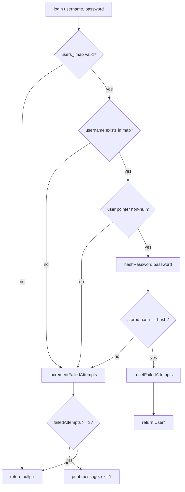
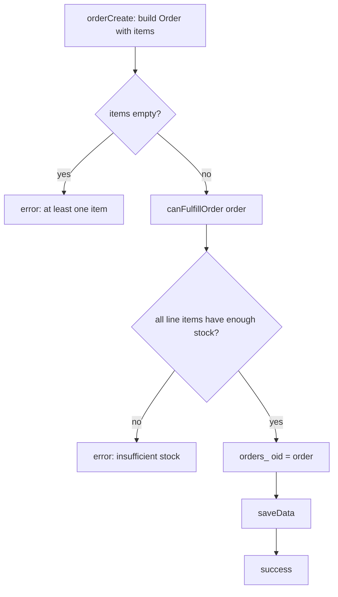
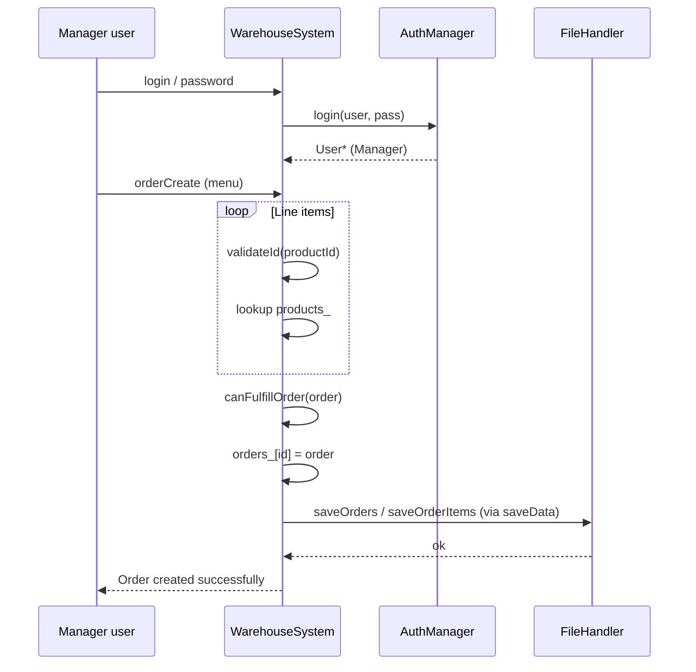
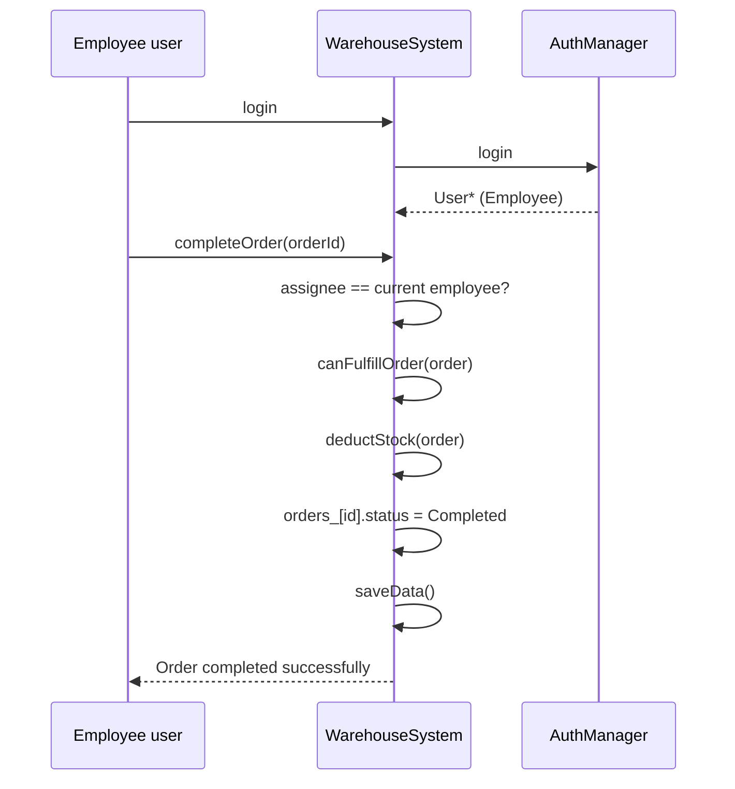

# Warehouse Inventory System — Testing strategy text and diagrams

Use the **paragraphs** in your report (Chapter 5 / appendices). **Diagrams**: copy the Mermaid blocks into [mermaid.live](https://mermaid.live) or a Markdown preview to **export PNG/SVG** for Word. If you use **PlantUML**, use the `.puml` file in this folder.

---

## 1. Report text (adapted to this project)

**Testing strategy (black box, white box, and automation)**  
Testing combined **black-box** user acceptance against requirements and sample CSV data (manager and employee flows) with **white-box** reasoning grounded in the implementation: control flow through `AuthManager`, `WarehouseSystem`, `FileHandler`, and domain classes, and the collaboration paths exercised by the executable suite in `TESTS/test_main.cpp`. Flow-oriented and sequence views (see diagrams below) support this white-box perspective by making branches and message paths explicit, so it is clear which parts of the architecture the automated checks are intended to cover.

**Unit / executable test suite**  
The **`WarehouseTests`** executable (`test_main.cpp`) runs a **framework-free** test runner that aggregates many `CHECK` assertions and **expected-error** checks on validation output. A successful run reports **Failed = 0** and prints a **Total** count of executed checks; execution typically completes in **milliseconds** on typical coursework hardware. The suite exercises **authentication** (`AuthManager`, `Manager`/`Employee` login), **domain models** (`Product`, `Order`, `OrderItem`), **CSV persistence** (`FileHandler` round-trips, including orders with trailing empty fields), **report generation** (`ReportGenerator`), **stock deduction** on completion, and **extensive input validation** via `WarehouseSystem` helpers. Together with UAT, this demonstrates alignment between **design modularity**, **code structure**, and **observed behaviour**—replace “Total = *N*” below with the value from your latest console run.

---

## 2. White-box flowchart — authentication and lockout (`AuthManager::login`)

Shows branches: missing user, invalid credentials (increment failures, exit on 3), success (reset counter).

---

## 3. White-box flowchart — create order (stock check path)

Reflects `canFulfillOrder` before persisting an order.

---

## 4. Sequence diagram — manager creates a pending order (simplified)

---

## 5. Sequence diagram — employee completes order (stock deduction)

---

## Notes for your report

- Replace the **Total** line in your narrative with the real `WarehouseTests` output.  
- If your coursework forbids external URLs in the PDF, **do not** link mermaid.live—only export images.  
- Caption examples:  
  - *Figure X — White-box flow: authentication and lockout paths.*  
  - *Figure Y — Sequence diagram: manager order creation and persistence.*
